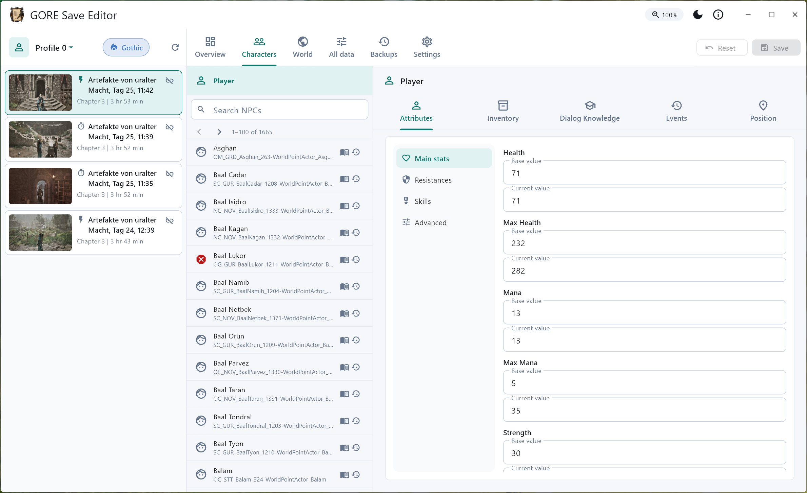
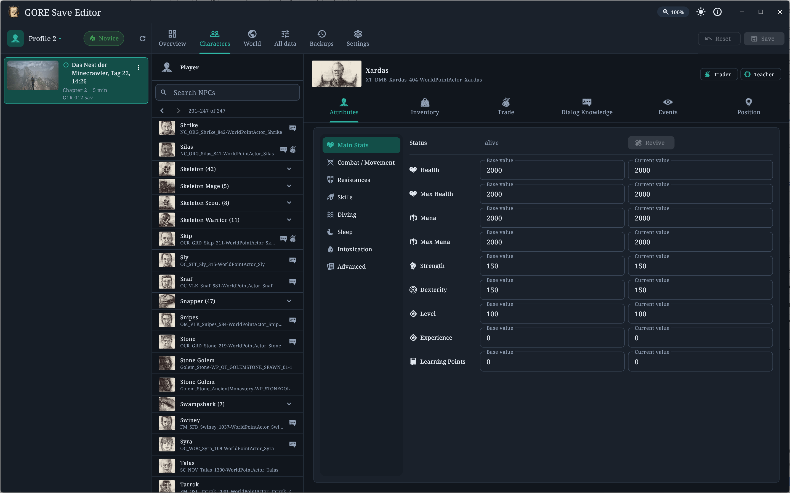

# GORE Save Editor

`gore-save` is the savegame editor for Gothic Remake. It
provides a Flutter interface backed by a Rust savegame core. It is one project
in the [gore](../../README.md) monorepo.

This is *not* modding — it changes your saved progress and never touches the
game install. For modding, use the [`gore` CLI](../../docs/guide/README.md) or
[Mod Studio](../mod-studio/README.md).

## Features

- Profile: Change difficulty settings; set the in-game time (play clock).
- Player & NPCs: Edit stats, attributes, all talents/skills and much more;
  revive a dead NPC (restore health, strip the death state).
- Position: Move the player to exact coordinates or a named location, with an
  optional facing direction. An NPC can be moved the same way, and his
  daily routine switched off so he stays where he was put instead of walking
  back; the editor records what it overwrote so the move can be undone.
- Inventory: Change count of existing items; add new items from a bundled
  catalog, grouped by the game's own inventory tabs; remove items; detect and
  repair damaged slot IDs; reset an inventory to a clean starting state.
  Hovering an item shows the stat block the game shows: type, damage or spell
  levels, protection, requirements, value and description.
- Game images: With the game installed, item pictures and the game's own
  attribute, protection, skill, quest and category icons are extracted from your
  installation and shown next to their labels, and the glossary shows the game's
  own character portraits. Everything works without them.
- Faction crimes: Clear an NPC's crimes to reset the hostility its guild holds
  against you.
- Glossary: Browse and edit NPC, creature, and location entries, including
  their individual text entries and NPC discovery states.
- Progression: Edit quest markers, NPC knowledge and events
- Trade: See what a merchant sells and how much ore he has to buy with; change
  stock counts, add or remove lines, and adjust the merchant's restock timing.
- Almost all data can be changed by changing the value of the internal property. Only for experimental use.
- Backups: Create them automatically, give them optional display labels,
  restore them, or permanently delete them after confirmation. Deletion cannot
  be undone.

## What it can not do

- Mod the game (no overrides, audio, textures, or scripts).
- Touch the game install in any way.
- Guarantee experimental raw property edits are safe — keep your own copy of
  important saves.

## Screenshots

[](../../docs/images/screenshot_light.png)
[](../../docs/images/screenshot_dark.png)

## Compatibility

Tested with Steam game version CL168781. Other game versions are not guaranteed:
the bundled item, item-stat, lock and named-location catalogs come from specific
game cooks and can become stale when a patch moves, renames or changes game data.
Keep backups and use a Save Editor build qualified for the updated game
version.

The bundled item stats (`assets/item_stats.json`) carry what the shipped script
cache says about every item — its type tag, damage, requirements, value and
description key — plus the game's own inventory filter tables.
`assets/glossary_images.json` maps each glossary entry to its portrait file.
`assets/lock_catalog.json` lists every lockable chest and door in the game with
its difficulty, keys and region — a save records only the locks the player has
already opened, so the Welt tab's lock list needs the other half from here.
Regenerate all three after a game update with the scripts in
`apps/save-editor/tools/`; each file header documents the commands.

The glossary portraits themselves are not bundled: they are loose PNGs in the
installation under `G1R/Story/Conversation/images/Glossary/`, read from there
directly.

## Installation & Updates

Download `gore-save-editor-<version>-setup.exe` from the
[latest release](https://github.com/dh0er/gore/releases/latest) and run it.
The app checks for updates on startup and prompts you when a new version is
available.

A portable zip is also attached to each release. The portable build does not
replace itself: when a new version is out it opens the release page, and you
replace your files with the new download.

On Linux, download `gore-save-editor-<version>-linux-x64.tar.gz` from the same
release, unpack it anywhere you can write to, and start `goresave` inside the
unpacked folder:

```sh
tar -xzf gore-save-editor-<version>-linux-x64.tar.gz
./gore-save-editor-<version>-linux-x64/goresave
```

It needs GTK 3, which desktop distributions and SteamOS already ship. Like
the portable zip, it checks for new versions and opens the release page
instead of updating itself.

## Requirements

- Windows 10 or newer for the released installer and portable builds.
- Linux x64 for the released tarball and for running from source.
- Rust toolchain.
- Flutter with Windows desktop support on Windows, or Linux desktop support on Linux.
- Visual Studio 2022 with Desktop development with C++ for Windows builds.

The local development setup used for this repository is Flutter 3.44.0, Dart
3.12.0, and Rust 1.96.0.

## Build And Test

Dev commands run from this directory (`apps/save-editor/`). `cargo` resolves
the workspace at the monorepo root automatically.

Run the Rust workspace tests (with `gore/development-cli` enabled), Flutter
analysis, and Flutter tests:

```powershell
python test.py
```

Run the Flutter app (build the native core first so the loader's upward search
finds the native library under the workspace `target/`):

```powershell
cargo build -p gore-save
flutter run -d windows
```

On Linux, install Flutter's Linux desktop dependencies, then run the Linux
target:

```sh
sudo apt install clang cmake ninja-build pkg-config libgtk-3-dev libstdc++-12-dev
cargo build -p gore-save
flutter run -d linux
```

The Linux desktop runner is also available through the repository build helper:

```sh
python ../../build.py gore-save-editor run --debug
```

This library-only build needs no CLI compiler bundle or `development-cli`
feature. Select `gore-save` explicitly: a bare workspace build also includes
the gated `gore` binary (see [Building](../../docs/development.md)).

Build a Windows release bundle (native DLL + Flutter release + packaged zip)
via the monorepo build script, from the repository root:

```powershell
python build.py gore-save-editor dist
```

Add `installer` instead of `dist` to also compile the Inno Setup installer.

On Linux, the same `dist` command builds the native `libgore_save.so` and the
Flutter Linux bundle, and packs `dist/gore-save-editor/gore-save-editor-<version>-linux-x64.tar.gz`.

## Safety

`gore-save` writes backups before modifying save files. Even so, keep your own
copy of important saves before editing them.

## License

This project is licensed under the MIT License. See [LICENSE](../../LICENSE).
